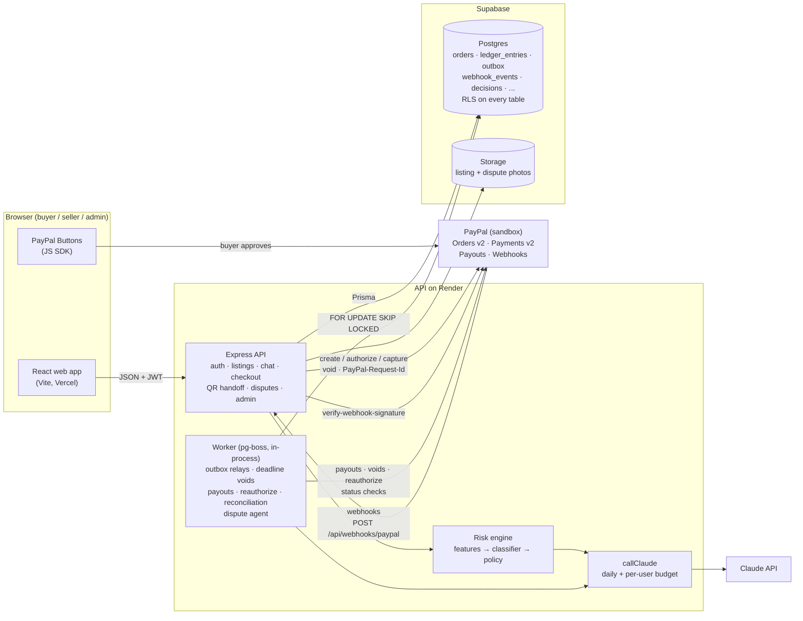

# Architecture

Campus Marketplace is a student-to-student marketplace where PayPal holds the buyer's money until the item changes hands. This page shows how the pieces fit together and why we chose authorize-then-capture over taking the money up front.

The one rule everything follows: **PayPal is the source of truth for money; our database is the source of truth for intent.** Most of the system exists to keep the two in agreement when requests fail, retry or arrive out of order.

## System diagram

### How a sale flows through it

1. **Checkout.** The buyer clicks Pay. The API creates our order (`CREATED`), and the risk engine scores it: deterministic features (seller account age, listing burst, price vs. category median, past disputes, off-platform payment phrases in chat), then a Claude classifier, then a deterministic policy layer. The hard rules set a floor that the LLM can raise but never lower. High risk → `BLOCKED` and PayPal is never called. Otherwise the API creates a PayPal order with `intent: AUTHORIZE`.
2. **Authorize.** The buyer approves in the PayPal popup. In **one database transaction**, the API moves the order `CREATED → AUTHORIZED`, sets the handoff deadline (72 h, or 120 h for a medium-risk "longer hold"), and posts `escrow_held +amount / buyer_funds −amount` to the ledger.
3. **Handoff.** The seller shows a QR code: a signed token bound to the order, seller, a single-use nonce and a 5-minute expiry. The buyer scans it from their logged-in session. The server checks all four, marks the nonce used, captures through PayPal, and in one transaction moves the order to `CAPTURED` and posts `escrow_held −amount / seller_payable +share / platform_fees +fee` (10% fee). Every scan is logged as dispute evidence.
4. **Payout.** The worker sends the seller's share through PayPal Payouts (`CAPTURED → PAYOUT_PENDING → PAID_OUT`, posting `seller_payable → paid_out`). The `sender_batch_id` is `payout-<orderId>-<attempt>`, so a retry after a timeout can't pay twice; definite failures go to `PAYOUT_RETRY` and are re-sent with backoff, up to 5 attempts.
5. **No handoff?** The worker voids the authorization when the deadline passes (`AUTHORIZED → VOIDED`). The buyer is never charged.
6. **Problem?** The buyer reports it (`AUTHORIZED → IN_DISPUTE`). The worker runs the dispute agent: Claude reads the order, chat, photos, QR log and ledger through read tools and proposes exactly one action (full refund, partial refund, release, escalate). A deterministic gate executes it, and anything over $25 waits in the admin approval queue. **The LLM never moves money directly.**

### Reliability pieces

| Problem | What handles it |
|---|---|
| Two requests change the same order | One `transition(orderId, from, to, expectedVersion)` with optimistic concurrency: `UPDATE ... WHERE version = $expected`; zero rows means someone else won. Illegal moves are rejected. |
| A side effect must happen exactly when the state changes | Transactional outbox: the state change, ledger entries and outbox row commit together. The worker claims rows with `FOR UPDATE SKIP LOCKED`, retries with exponential backoff, and dead-letters after 5 failures. |
| PayPal call times out, then we retry | Every create / authorize / capture / void / reauthorize sends a `PayPal-Request-Id` derived from order ID + action, so PayPal replays the first result instead of charging twice. |
| Webhooks arrive twice, late or out of order | Signature verified with PayPal's `verify-webhook-signature`; stored with `UNIQUE(event_id)` + `ON CONFLICT DO NOTHING`; answered 2xx immediately and processed by the worker. Events for an order already past that state are logged and dropped. |
| Our ledger and PayPal disagree | Reconciliation job compares per-order held / captured / paid-out totals with PayPal's records and flags mismatches on the admin dashboard. It never "fixes" anything itself. |
| Authorization outlives PayPal's 3-day honor period | Reauthorize job gets a new authorization ID (restarting the honor period) for orders still waiting, and voids within a day of the 29-day expiry. |
| Money bugs | Double-entry ledger in integer cents. A database trigger refuses any transaction whose entries don't sum to zero, and another makes `ledger_entries` append-only. There are no balance columns. |
| Prompt injection in listings or chat | Listing and chat text are passed to Claude as delimited untrusted data, hard rules run without the LLM, and every AI output is schema-validated JSON that feeds a deterministic policy. Invalid output falls back to medium risk / admin review. |
| Runaway AI spend | Every Claude call reserves budget first through `callClaude`: at most 300 calls per UTC day and 20 per user. |

The admin dashboard (AG Grid) shows orders by state, ledger money tiles, reconciliation flags, dead-letter outbox items, AI decisions and the dispute approval queue. Its "chaos" buttons trigger failure scenarios live in the sandbox.

## Payment model tradeoff: authorize-then-capture vs. capture-and-hold

There are two ways to build marketplace escrow on PayPal:

- **Capture-and-hold:** capture the buyer's payment at checkout into the platform's PayPal account, keep it there until the handoff, then pay the seller (or refund the buyer).
- **Authorize-then-capture (what we do):** at checkout PayPal only *authorizes* the payment. The funds stay in the buyer's account and are reserved for us. We capture at the QR scan and void if the handoff never happens.

| | Authorize-then-capture | Capture-and-hold |
|---|---|---|
| Who holds the money before the handoff | The buyer's own PayPal account (a hold, not a transfer) | The platform |
| Buyer experience when a sale falls through | The hold is released and they were never charged | They were charged and wait for a refund |
| Cost of a cancelled sale | A void costs nothing | A refund, and processing fees usually aren't returned |
| Guarantee the money is there | Only during the 3-day honor period; a capture after it can fail if the buyer's funds are gone | Funds are already captured |
| How long a sale can wait | 29 days at most (the authorization expires), with reauthorizations after day 3 | As long as the platform wants |
| Operational complexity | Higher: honor periods, reauthorization (new ID each time), expiry voids | Lower on the PayPal side, higher on the compliance side |

**Why authorize-then-capture fits a campus marketplace.** Most handoffs happen within a day or two, so our 72-hour handoff deadline matches PayPal's 3-day honor period and the normal flow never needs a reauthorization. Orders that wait longer, like a medium-risk 120-hour hold or an open dispute, are reauthorized by the worker and must be settled before day 29. For a $40 textbook, "you were never charged" beats "you'll be refunded in 3 to 5 days."

**The regulatory reason.** Capturing buyers' money and holding it until we decide who gets it means the platform is holding other people's money. That's usually a regulated activity: in the US it can make the platform a money transmitter (state licenses, FinCEN registration), and in Canada, where our pilot campus is, the Retail Payment Activities Act requires payment service providers that hold end users' funds to register with the Bank of Canada and safeguard those funds. With authorize-then-capture, PayPal (already licensed and regulated) keeps the money in the buyer's account until the handoff, and we only send instructions. *(A design note, not legal advice.)*

**The limitation.** After capture, the seller's share sits in our PayPal business balance until the payout goes out, usually within minutes. That short window is still the platform holding seller funds. A production version would close it with PayPal's marketplace product, e.g. a PayPal Commerce Platform partner integration where the seller is the payee on the order and the platform fee is split off by PayPal, so the platform never holds the funds. That requires partner onboarding, so it's out of scope for the hackathon.
